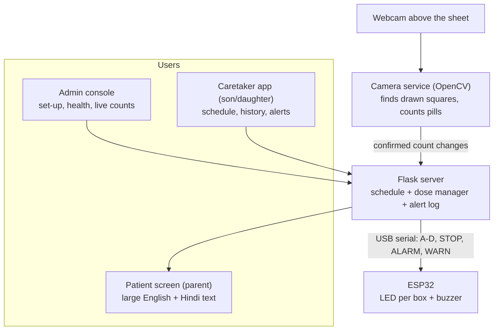
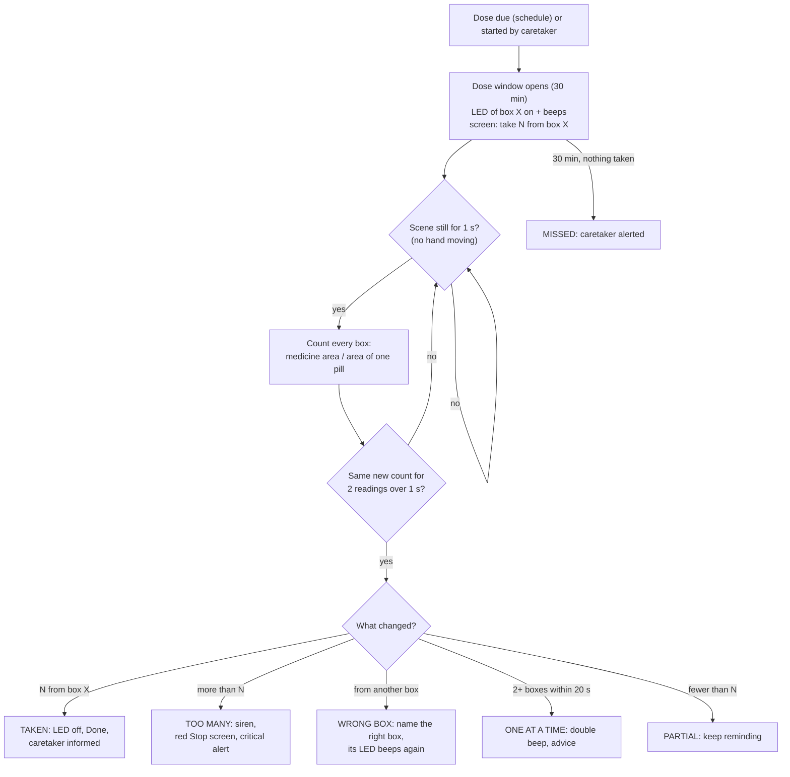

# MedVerify: a pill box that checks, not just reminds

MedVerify is an IoT pill box for elderly patients. At dose time it lights the right compartment
and beeps. A camera above the box then **counts the pills in every compartment** and confirms
that the right number left the right compartment. If something goes wrong (too many pills, the
wrong box, a missed dose), the patient is told at once, in English and Hindi, and the family is
informed remotely.

> **Safety boundary.** The camera sees pills leaving the box. It never claims the pill was
> swallowed. Uncertain views (a hand in the way, a moved camera) are reported, never guessed.

| | |
|---|---|
| **Team** | Anuj Sharma (23BCP289), Ishaan Goswami (23BCP290) |
| **Guide** | Dr. Ketan Sabale |
| **Hardware** | ESP32 DevKit, 4 LEDs, buzzer, USB webcam, laptop |
| **Software** | Python, OpenCV, Flask, Arduino (C++) firmware |
| **Working demo** | Git tag [`demo-working-2026-11-02`](https://github.com/AnujSharma-05/Medvfy/tree/demo-working-2026-11-02) |

---

## A practical scenario: the Sharma family

**Ramesh Sharma is 74** and lives in Ahmedabad with his wife. He takes four medicines a day for
blood pressure, diabetes and his heart. His eyesight is not what it was, and the pill strips look
alike. Twice last month he could not remember whether he had already taken the evening tablet, so
he took it again.

**His daughter Priya** works in Bengaluru, 1,500 km away. She calls every evening and asks the same
question: *"Papa, did you take your medicine?"* He always says yes. She can never be sure, and she
cannot leave her job to sit beside him.

**Rohan, the installer (the admin)**, sets up MedVerify on the old laptop at home. He tapes the sheet
with four drawn compartments, A to D, under the webcam. He plugs in the small box with four lights
and a buzzer, and opens the **admin console**. The camera finds the four squares by itself. Rohan
takes one photo of the empty sheet and one with the medicines in, typing how many are in each box.
`mv status` shows *A=4, B=4, C=4, D=3*. Set-up done in two minutes.

**Priya opens the caretaker app** on her phone and logs in with her password. She sets the schedule:
*8:00 box A, 1 pill; 14:00 box B, 1 pill; 21:00 box C, 1 pill.*

**At 8:00 in Ahmedabad**, the light over box A turns on and the buzzer beeps. The tablet beside
the box shows, in big letters: **"Take 1 pill from box A"**, with the same line in Hindi. Ramesh
takes one pill and moves his hand away. Two seconds later the light goes off, the screen says
**"Done"**, and on Priya's phone the dose shows as *taken at 8:01*.

**At 14:00**, Ramesh is distracted and takes **two** pills from box B. The box gives a siren and
the screen turns red: **"Stop! You took 2 pills from box B. The dose is 1. Put the extra back."**
He puts one back. Priya gets a **critical** alert, and calls him to make sure he is fine.

**At 21:00**, he takes a pill from box **D** by mistake. Two seconds after his hand leaves, the
screen says **"Wrong box! Not D. Put it back and take from box C"**, and box C's light beeps again. He
puts it back and takes from C, and the dose is accepted.

**One afternoon the grandchildren visit** and the sheet gets pushed. The camera can no longer see
the boxes properly. Instead of silently stopping, MedVerify sends Priya a critical **"Camera or
sheet moved"** alert. Rohan redoes the two-minute set-up the same evening.

**What changed for the family:** Priya no longer has to ask; she knows. Ramesh no longer has to
remember whether he took it; the box tells him, and stops him when something is wrong.

---

## How it works



### What happens during a dose



More diagrams: [docs/flow-map.html](docs/flow-map.html) (open in a browser), and the flowchart and
pin diagram in the lab report, [docs/report/](docs/report/).

### The counting idea in one paragraph
At set-up the camera takes a photo of the **empty** sheet and one with known counts. Anything that
differs from the empty photo, in colour or brightness, is medicine. Its **area divided by the area of
one pill** gives the count. Area does not change when pills are moved around or touch each other, so
the count stays stable while the patient handles the box. Nothing is judged while a hand moves. An
object lying across a square's pen line (a hand reaching in) blocks that box's reading.

---

## Quick start (Windows, from the project folder)

| What | Command |
|---|---|
| **Live demo** with the ESP32 plugged in | `live_demo.bat` |
| **Software-only rehearsal** (same flow, simulated box) | `software_demo.bat` |
| **Camera set-up** (camera or sheet moved), guided | `setup_camera.bat` |
| Put back an earlier camera set-up | `restore_camera.bat` |
| Status, doses, box tests (all commands: `mv help`) | `mv status`, `mv dose start A pills=1`, `mv box test` |
| Stop everything | `mv down` |
| Run the 265 automated tests | `mv test` |

The three apps open by themselves:

| App | Address |
|---|---|
| Admin console | <http://127.0.0.1:5000/console> |
| Patient screen | <http://127.0.0.1:5000/patient> |
| Caretaker app | <http://127.0.0.1:5000/care> |

First-time install: `python -m venv .venv`, then `.venv\Scripts\pip install -r requirements.txt`.

**Before every demo:** tape the sheet and fix the camera. Once the camera has been on for a minute,
run `mv cam loaded A=4 B=4 C=4 D=3` with the real counts. The full presenter guide is in
[docs/DEMO_SCRIPT.md](docs/DEMO_SCRIPT.md).

---

## Hardware

| ESP32 pin | Connected to |
|---|---|
| GPIO16 / 17 / 18 / 19 | LED A / B / C / D (each through a 220–330 Ω resistor) |
| GPIO25 | Buzzer signal (buzzer + to 3V3, − to GND) |
| GPIO2 | On-board status LED |
| USB (CP210x), 115200 baud | Laptop. The commands are `A`–`D`, `STOP`, `ALARM` and `WARN`; the box replies to each. |

Firmware: [MedVerify_Controller/MedVerify_Controller.ino](MedVerify_Controller/MedVerify_Controller.ino),
flashed from VS Code with `mv firmware upload`. Wiring details: [docs/HARDWARE_CONNECTIONS.md](docs/HARDWARE_CONNECTIONS.md).

---

## Project structure

The files stay where the launchers expect them, so everything runs from the project folder.

```
Medvfy/
├── live_demo.bat            ▶ start the live demo (ESP32 + camera + 3 apps)
├── software_demo.bat        ▶ same demo with a simulated box
├── setup_camera.bat         ▶ guided camera set-up (backs up the old one first)
├── restore_camera.bat       ▶ put back a saved camera set-up
├── mv.bat                   ▶ the control tool: mv up | down | status | dose | cam | box | test
│
├── backend/                 Flask server
│   ├── app.py                 API, scheduler, the three web apps
│   ├── dose_manager.py        dose windows and every outcome (taken, too many, wrong box, ...)
│   ├── device_adapter.py      ESP32 over USB serial; simulated box; Wi-Fi mode (planned)
│   ├── schedule.py, notifier.py, auth.py, commands.py
│   └── static/                patient.html, care.html, console.html
├── vision/                  camera service (OpenCV)
│   ├── camera_service.py      runs the webcam, set-up commands, reports counts
│   ├── drawn_regions.py       finds the pen-drawn squares
│   ├── content.py             counting: medicine area, hand guard, count confirmation
│   ├── monitor.py             "is the scene still?" gate and per-box evaluation
│   └── frame_quality.py, reference_store.py, roi_manager.py, state_machine.py, ...
├── MedVerify_Controller/    ESP32 firmware (Arduino C++)
├── config/                  settings.json, tuning.json (demo timing/tolerance), schedule.json
├── tools/                   mv.py (behind mv.bat), guided demo, hardware check, fake camera
├── tests/                   265 automated tests (synthetic + real photos of our sheet)
├── docs/                    guides, demo script, viva preparation, lab reports
└── data/                    runtime data: calibration photos, logs, dose history (not in git)
```

Older launchers kept for reference: `run_medverify.bat`, `run_server.bat`, `run_camera.bat`,
`run_fake_camera.bat`, `run_tests.bat`, `run_evaluate.bat`, `run_hardware_check.bat` and
`start_demo.sh`. Use the ▶ ones above. In particular, don't use `run_medverify.bat` together with
`mv up`: it starts a second copy.

---

## Documents

| Document | For |
|---|---|
| [docs/DEMO_SCRIPT.md](docs/DEMO_SCRIPT.md) | The 7-minute demonstration, step by step |
| [docs/VIVA_PREP.md](docs/VIVA_PREP.md) | Full presentation script and short answers to likely questions |
| [docs/EVALUATOR_QA.md](docs/EVALUATOR_QA.md) | Detailed technical Q&A about this project |
| [docs/HOW_IT_WORKS.md](docs/HOW_IT_WORKS.md) | End-to-end explanation and known limits |
| [docs/HANDOFF.md](docs/HANDOFF.md) | Current state, what was fixed and why (for the next session) |
| [docs/TECHNICAL_REFERENCE.md](docs/TECHNICAL_REFERENCE.md) | The previous README: states, modules, inspector keys |
| [docs/report/](docs/report/) | IoT lab reports (PDF and Word) |

## Limits, honestly
- Pills must lie in a single layer, with one kind of pill per box.
- The camera and sheet must stay fixed. If they move, an alert says so and set-up takes 2 minutes.
- White pills on white paper are hard to see; use a coloured tray.
- Crumpled paper "pills" vary in visible size. Real flat tablets count more precisely.
- MedVerify confirms removal from the box, not swallowing.

## Next steps
- Wi-Fi firmware, so the box needs no USB cable.
- Phone push notifications (ntfy is built in, but off).
- A 3D-printed box with a fixed camera mount.
- A per-pill colour check, so a wrong medicine put in a box is noticed.
